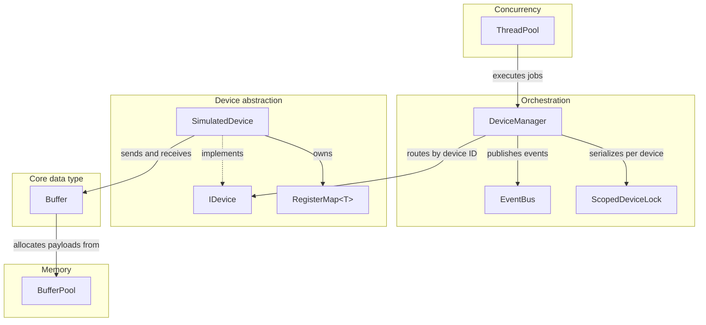

# MiniSDK

[](https://github.com/donKljestan/minisdk/actions/workflows/ci.yml)

A C++20 device-management SDK featuring packet buffers, a custom pool allocator, register maps, per-device synchronization, a publish/subscribe event bus, and a thread pool.

The device layer is simulated; the SDK does not interface with physical hardware.

## C++ Topics Covered

| Area | Concepts and components |
| --- | --- |
| **Object lifetime and semantics** | Constructors, destructors, `explicit`, Rule of Five, Rule of Zero, copy/move semantics, copy-and-swap, self-assignment, operator overloading, `const` correctness |
| **Object-oriented design** | Encapsulation, abstract interfaces, inheritance, virtual functions, virtual destructors, runtime polymorphism |
| **Memory management** | RAII, raw pointers, `std::unique_ptr`, `std::shared_ptr`, ownership and lifetime, alignment, custom pool allocator, intrusive free lists |
| **Generic programming and STL** | Class templates, `std::vector`, `std::unordered_map`, `std::queue`, STL algorithms, lambdas, `std::function` |
| **Concurrency and synchronization** | `std::thread`, `std::mutex`, `std::shared_mutex`, `std::lock_guard`, `std::unique_lock`, `std::condition_variable`, `std::atomic`, `thread_local` |
| **Concurrent systems design** | Producer-consumer queues, thread pool, graceful shutdown, per-device locking, race prevention, reentrancy, false sharing, exception safety |
| **Build, verification and performance** | CMake, Catch2, CTest, GitHub Actions, GCC/Clang, ASan, UBSan, TSan, Valgrind, benchmarking |

Implementation rationale, trade-offs, and measurements are documented in [Design Notes](docs/DESIGN.md).

## Architecture



## Correctness and Verification

| Behavior | Verification |
| --- | --- |
| Buffer ownership, Rule of Five, self-assignment and self-append | `tests/test_buffer.cpp` |
| Pool allocator performance relative to `new[]` | `bench/bench_allocator.cpp` |
| Concurrent senders preserve counter increments | `tests/test_device_manager.cpp` |
| Subscribers can modify the event bus from callbacks | `tests/test_event_bus.cpp` |
| Exceptions from jobs do not terminate the thread pool | `tests/test_thread_pool.cpp` |
| Unknown device IDs and registers are rejected | `tests/test_simulated_device.cpp`, `tests/test_device_manager.cpp` |
| Data-race detection | ThreadSanitizer CI job |
| Memory leak checking | Valgrind |

**Reported verification:** 59 test cases, 2,240 assertions. CI configurations cover GCC and Clang, Debug and Release, and sanitizer runs with ASan, UBSan and TSan.

## Performance Highlights

`BufferPool` serves payloads from preallocated fixed-size blocks, with larger requests forwarded to the global allocator. Representative measurements compared with `new[]`/`delete[]`:

| Scenario | `new[]` | Pool | Reported speedup |
| --- | ---: | ---: | ---: |
| 1,500 B, 1 thread | 28.1 ns | 17.6 ns | **1.64×** |
| 64 B, 1 thread | 18.6 ns | 12.2 ns | **1.53×** |
| 9,000 B, larger than a pool block | 98.6 ns | 103.1 ns | 0.98× |
| 1,500 B, 4 threads | 18.5 ns | 12.6 ns | **1.54×** |
| 1,500 B, 8 threads | 16.4 ns | 10.8 ns | **1.57×** |

Per allocate/touch/free cycle; GCC 13.3, `-O2`, 16 hardware threads, median of 11 interleaved runs on one developer machine. Speedups are medians of per-run ratios, so they may differ from ratios of displayed timings. Results are environment-specific and are not universal performance guarantees.

The allocator evolved from a single mutex and free list to sharded lists and a per-thread cache. The original single-mutex design was approximately 8× slower than `new[]` in the 8-thread scenario. See [Design Notes](docs/DESIGN.md#3-allocator-iterations-and-performance-trade-offs) for the iterations and benchmark methodology.

## Build and Run

Requires Linux, CMake 3.20+, and a C++20 compiler (tested with GCC 13 and Clang 18).

```bash
cmake -S . -B build -DCMAKE_BUILD_TYPE=Debug
cmake --build build --parallel
ctest --test-dir build --output-on-failure
./build/minisdk_demo
```

Release benchmark build:

```bash
cmake -S . -B build/release -DCMAKE_BUILD_TYPE=Release
cmake --build build/release --parallel
./build/release/bench/minisdk_bench
```

| CMake option | Default | Description |
| --- | --- | --- |
| `MINISDK_BUILD_TESTS` | `ON` | Build Catch2 tests and register with CTest |
| `MINISDK_BUILD_BENCH` | `ON` | Build allocator benchmark |
| `MINISDK_TRACE` | `OFF` | Enable compile-time lifetime and I/O tracing |
| `MINISDK_SANITIZE` | empty | Select `address`, `undefined`, or `thread` |

Example TSan configuration:

```bash
cmake -S . -B build/tsan -DCMAKE_BUILD_TYPE=Debug -DMINISDK_SANITIZE=thread
cmake --build build/tsan --parallel
ctest --test-dir build/tsan --output-on-failure
```

On the documented Ubuntu 24.04 setup, TSan may require `sudo sysctl -w vm.mmap_rnd_bits=28` before execution; see [environment notes](docs/DESIGN.md#7-environment-notes). Catch2 is resolved from the system or fetched during configuration.

## Repository Layout

```text
include/minisdk/   Public SDK headers
src/               Implementations and demo application
tests/             Catch2 component tests
bench/             Allocator benchmark
docs/DESIGN.md     Architecture, trade-offs, and measurements
.github/workflows/ CI configuration
```

